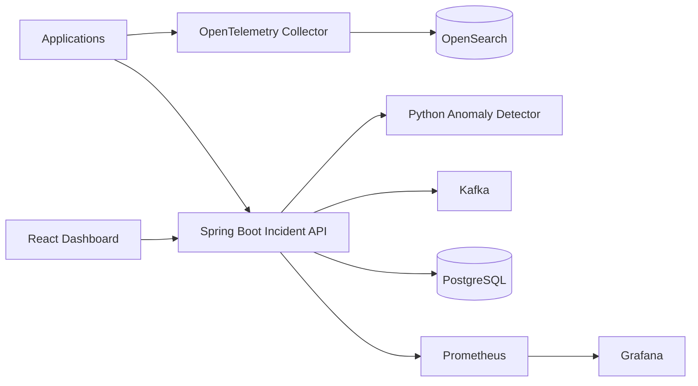

# AI-Powered AIOps and Incident Management Platform

An MVP implementation for anomaly detection, alert correlation, automatic incident creation, remediation suggestions, incident reporting, and MTTD/MTTR measurement.

## Stack

- Java 21 / Spring Boot 3.5
- Maven multi-module build
- FastAPI statistical anomaly detector
- React dashboard
- PostgreSQL
- Kafka
- OpenSearch
- OpenTelemetry Collector
- Prometheus
- Grafana
- Docker Compose

## Run

From the repository root:

```powershell
docker compose -f aiops-incident-management/docker-compose.yml up --build
```

Build and test Java locally:

```powershell
.\mvnw.cmd -f aiops-incident-management/pom.xml test
.\mvnw.cmd -f aiops-incident-management/pom.xml package
```

Run detector tests:

```powershell
cd aiops-incident-management/anomaly-detector
python -m pip install -r requirements.txt
python -m pytest -q
```

Run the dashboard:

```powershell
cd aiops-incident-management/dashboard
npm install
npm run dev
```

## Service URLs

| Service | URL |
|---|---|
| Dashboard | http://localhost:3000 |
| Incident API | http://localhost:8080 |
| Swagger UI | http://localhost:8080/swagger-ui.html |
| API health | http://localhost:8080/actuator/health |
| Prometheus metrics | http://localhost:8080/actuator/prometheus |
| Anomaly detector | http://localhost:8000 |
| Prometheus | http://localhost:9090 |
| Grafana | http://localhost:3001 |
| OpenSearch | http://localhost:9200 |
| Kafka host listener | localhost:29092 |

## Seed scenario

The demo automatically exposes `INC-DEMO-001`, representing a checkout service latency spike from 100-200 ms to 2000 ms and an error-rate increase from 0.5% to 15%. The incident includes evidence, root-cause candidates, remediation recommendations, an 18-second MTTD, and a 900-second MTTR.

## Architecture


